<div align="center">

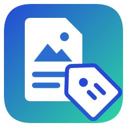

# MetaForge

### See what your files say about you, and remove it before you share them.

A file metadata viewer, editor and cleaner for Windows, written in **Rust**.
Photos can carry the GPS position where they were taken and the camera's serial number; documents carry author names, comment authors and template paths; videos from phones carry the place they were recorded. MetaForge shows all of it in plain language and removes it with one button, without re-encoding your pictures.

<p>
  
  
  
  
</p>

<p>
  
  
  
  
  
  
</p>

[**Features**](#-features) ·
[**Formats**](#-formats) ·
[**Screenshots**](#%EF%B8%8F-screenshots) ·
[**Download**](#-download) ·
[**Command line**](#%EF%B8%8F-command-line) ·
[**Developer**](#-developer)

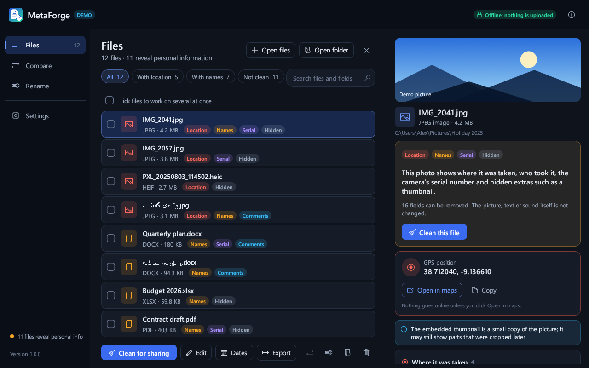

</div>

---

> [!NOTE]
> **First release.** Every format was tested with sample files that MetaForge's tests build themselves (invented names and places): reading, cleaning, editing and re-reading, with picture data checked to stay identical. Cleaned files were also opened with other tools: photos with Pillow, PDFs with pypdf, DOCX and ODT packages checked as ZIP and XML, and a real H.264 MP4 decoded by ffmpeg with identical frames. **Not yet tested:** opening the cleaned Office files in Word, Excel, PowerPoint or LibreOffice; photos straight from real phones and cameras (HEIC especially); very large files; and the installer itself. Please keep the default "save a copy" setting until you trust it with your own files.

## ✨ Features

<table>
<tr>
<td width="50%" valign="top">

### 🔍 See what is hidden
- Drop files or whole folders in, or use Open
- A badge on every file: **Location**, **Names**, **Serial**, **Comments**, **Hidden**, or **Clean**
- Details in plain language: *Where it was taken*, *Who made it*, *Device*, *Dates*, *Software*, *Hidden content*, *Windows traces*
- GPS shown as coordinates, with an optional "Open in maps" link (opened only when you click it)
- Search the fields, copy any value
- Kurdish, Arabic and other right-to-left names and values shown properly

</td>
<td width="50%" valign="top">

### 🧹 Clean for sharing
- One button, three choices: **Remove everything**, **Remove location and names only**, or **Custom**
- Photos are cleaned **without re-encoding**: the picture data stays byte for byte the same
- Keeps the photo orientation and colour profile unless you say otherwise
- Save a copy with a suffix, save copies to a folder, or replace the originals
- Batches with progress, then a before and after report
- Every cleaned file is **read back and checked** before it replaces anything

</td>
</tr>
<tr>
<td valign="top">

### ✏️ Edit
- Title, author, copyright, description, keywords, date taken
- Set or remove the GPS position of a photo
- Artist, album, genre, track and year for music
- File dates (created, modified, opened), or copy the date taken onto the file
- Rename files from their metadata, for example `{date}_{time}`

</td>
<td valign="top">

### 🧰 And also
- Export metadata to CSV or JSON
- Compare the metadata of two files side by side
- Shows "downloaded from" notes and other hidden NTFS streams, and removes them
- Optional Explorer right-click entries: **Show metadata** and **Clean metadata with MetaForge** (per user, removable)
- Command line for scripts: `--show`, `--clean`, `--export`
- Dark and light themes, no network requests, no telemetry

</td>
</tr>
</table>

## 📂 Formats

| Kind | Formats | Read | Edit | Clean |
|---|---|---|---|---|
| Photos | JPEG, PNG, WebP, TIFF | EXIF (GPS, camera, lens, serials, thumbnail), XMP, IPTC, ICC, PNG text | ✓ | ✓ lossless |
| | GIF | comments, XMP | comment | ✓ |
| | HEIC / AVIF | EXIF, XMP | | ✓ (blanked in place) |
| Documents | DOCX, XLSX, PPTX | properties, custom properties, comment and tracked-change authors, template, printer, thumbnail, hidden sheets, hidden slides, speaker notes | ✓ | ✓ |
| | ODT, ODS, ODP | properties, user fields, comment and change authors, printer, thumbnail | ✓ | ✓ |
| | PDF | Info dictionary, XMP, comment authors, document ID, older saved versions | ✓ | ✓ (full rewrite) |
| | RTF | info group, generator, user properties, revision authors | ✓ | ✓ |
| Audio | MP3, FLAC, OGG / Opus, WAV, M4A | ID3v1/v2 (incl. pictures), Vorbis comments, MP4 tags, RIFF INFO | ✓ | ✓ |
| Video | MP4, MOV | GPS, phone make and model, software, dates, tags, XMP | ✓ | ✓ (in place) |
| Any file | | NTFS alternate data streams (Zone.Identifier), file dates | dates | streams |

Cleaning never re-encodes: photo pixels, audio frames and video data stay as they are. Large videos are cleaned in place by blanking metadata boxes, so the file size stays the same.

## 🖼️ Screenshots

<table>
<tr>
<td width="50%" align="center"><b>A document's hidden details</b><br>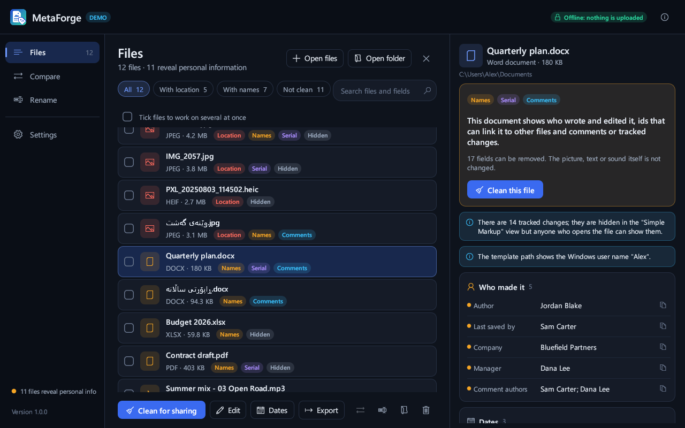</td>
<td width="50%" align="center"><b>A phone video</b><br>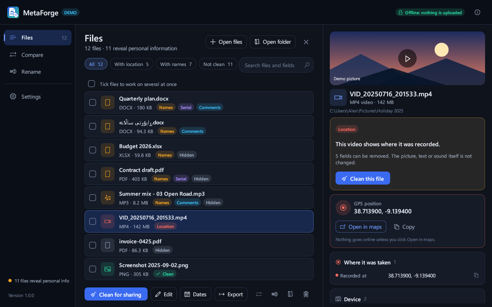</td>
</tr>
<tr>
<td width="50%" align="center"><b>Clean for sharing</b><br>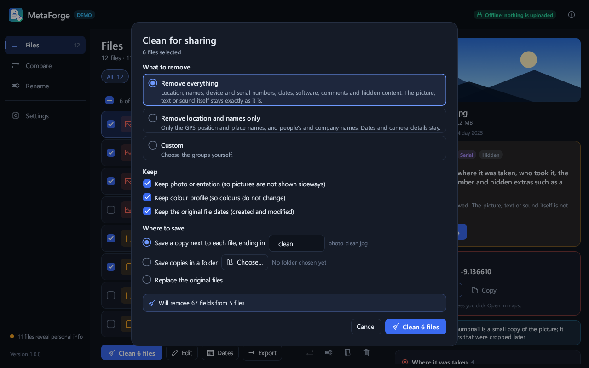</td>
<td width="50%" align="center"><b>Before and after report</b><br>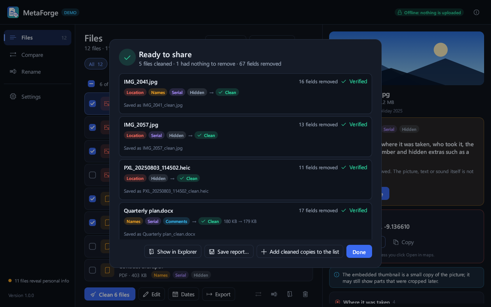</td>
</tr>
<tr>
<td width="50%" align="center"><b>Edit</b><br>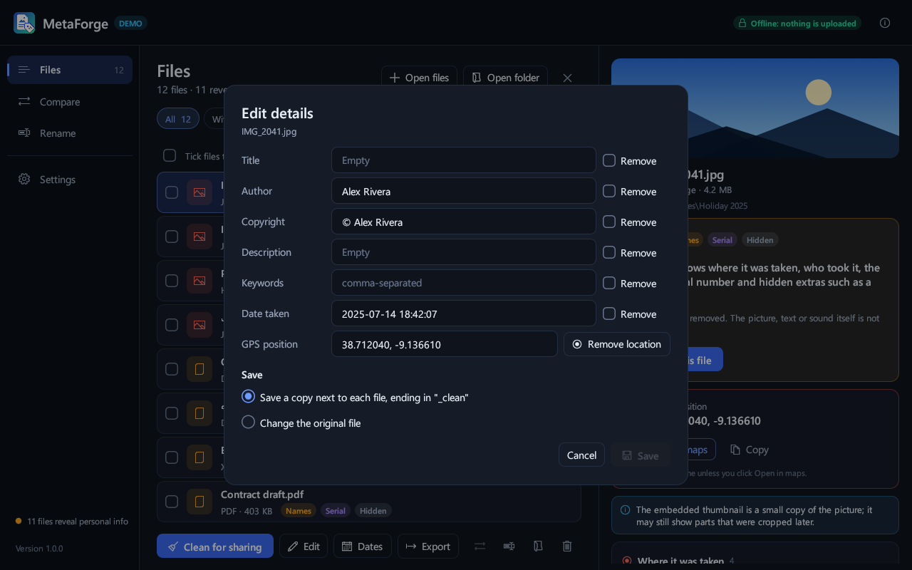</td>
<td width="50%" align="center"><b>File dates</b><br>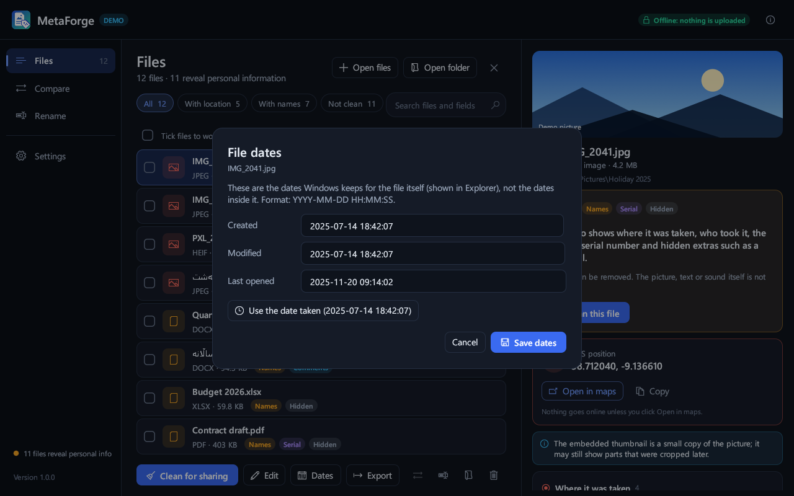</td>
</tr>
<tr>
<td width="50%" align="center"><b>Rename from metadata</b><br>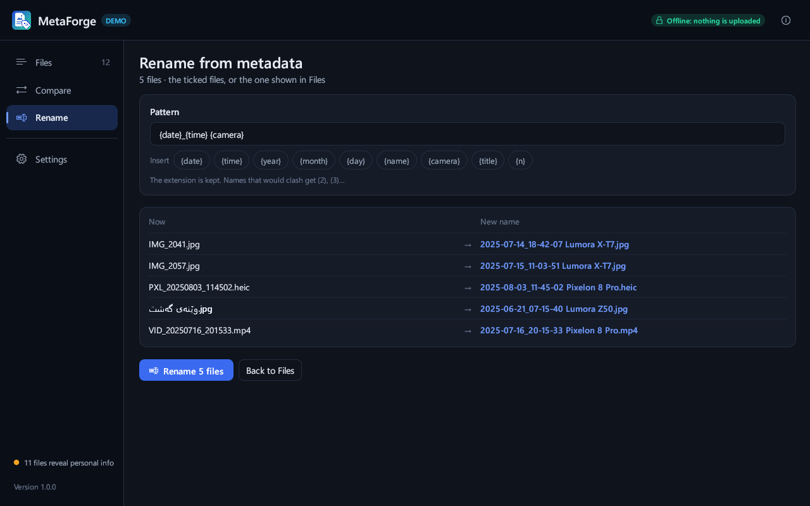</td>
<td width="50%" align="center"><b>Compare two files</b><br>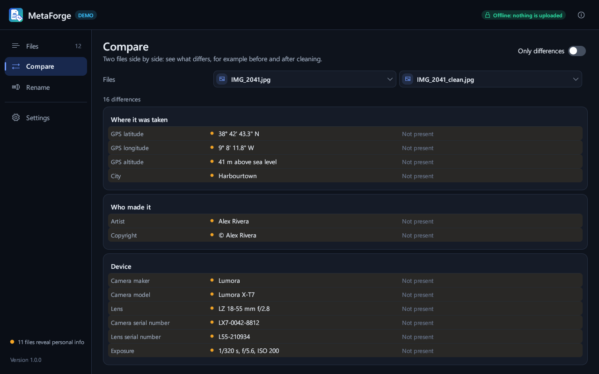</td>
</tr>
<tr>
<td width="50%" align="center"><b>Settings</b><br>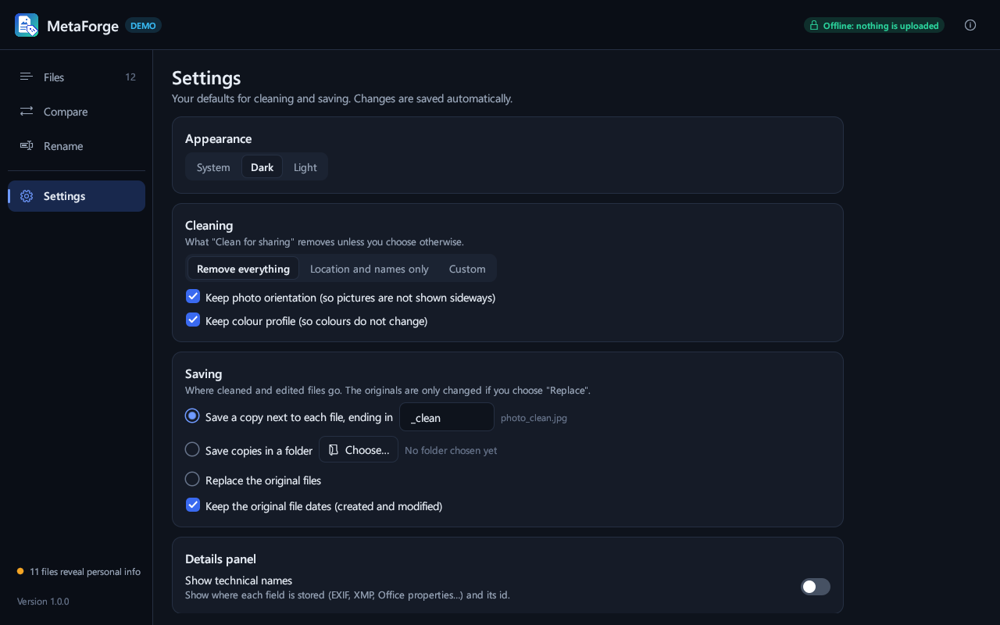</td>
<td width="50%" align="center"><b>Light theme</b><br>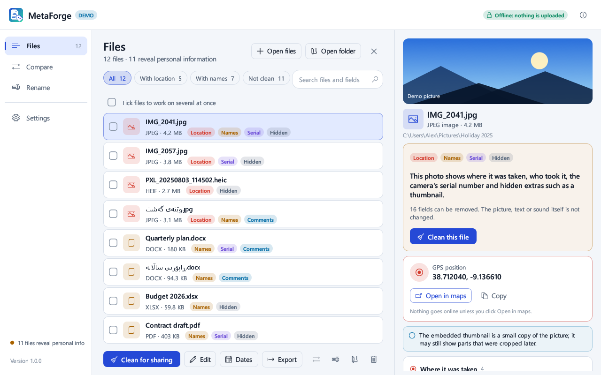</td>
</tr>
<tr>
<td colspan="2" align="center"><b>Kurdish and Arabic file names and values, joined and in the right order</b><br>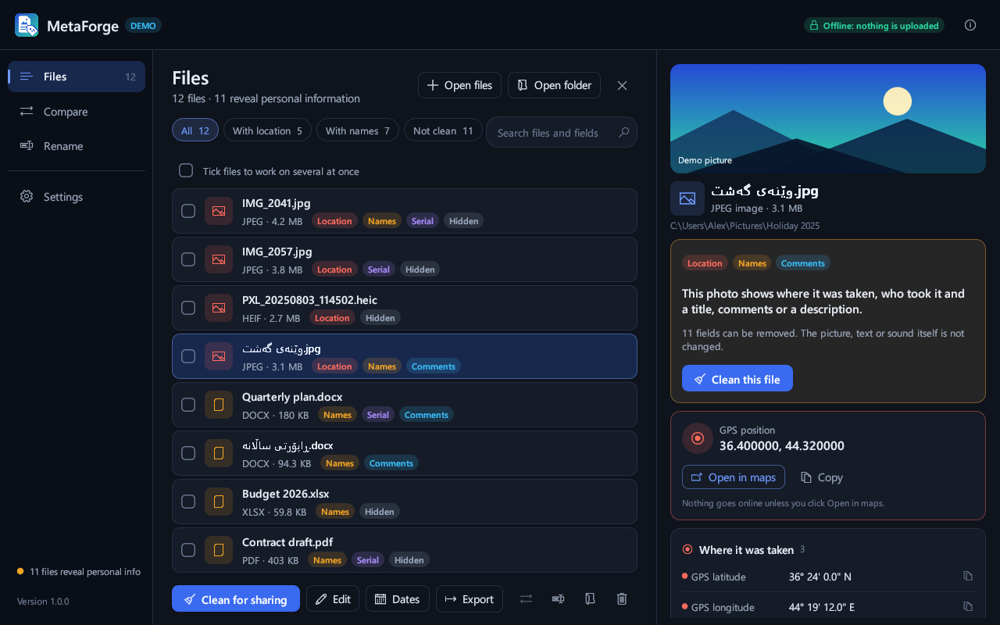</td>
</tr>
</table>

<sub>Screenshots use the built-in demo mode (<code>MetaForge.exe --demo</code>), with invented files, people and places.</sub>

## 📥 Download

Get it from the [**latest release**](https://github.com/zheerkhalid/metaforge/releases/latest):

| File | What it is |
|---|---|
| `MetaForge-Setup.exe` | Installer with shortcuts, the optional Explorer menu and an uninstaller |
| `MetaForge-x.y.z-portable-x64.zip` | Portable: unzip and run |
| `MetaForge.exe` | The bare 8.2 MB EXE |

MetaForge works without administrator rights. Settings are kept in `%LOCALAPPDATA%\MetaForge`.

Good to know:

- By default cleaned files are saved as **copies** (`photo_clean.jpg`); replacing the originals is a choice you make.
- Comments, tracked changes, speaker notes and hidden sheets are part of a document's *content*. MetaForge removes the names attached to them and tells you they are there, but does not delete them; do that in the document's own program if they should not be shared.
- Password-protected PDFs are shown but not changed.
- HEIC and AVIF photos are cleaned by blanking the metadata in place; editing them is not supported.
- Windows traces (download notes, file dates) usually do not travel with a file when it is uploaded or e-mailed, but alternate streams can travel on NTFS drives and in some archive formats.

## ⌨️ Command line

| Command | What it does |
|---|---|
| `MetaForge.exe --show photo.jpg [--json]` | Print what is hidden in a file |
| `MetaForge.exe --clean <files or folders> [--preset all\|location-names\|custom] [--remove location,people,...] [--out <folder>\|--suffix _clean\|--replace]` | Clean files, verify them and print a report |
| `MetaForge.exe --export <files or folders> --out meta.csv` | Save all metadata as CSV (or `.json`) |
| `MetaForge.exe --register-menu` / `--unregister-menu` | Add or remove the Explorer right-click entries |
| `MetaForge.exe --demo` | Invented files; nothing is read or changed |
| `MetaForge.exe --selftest` | Create sample files of every format in a temporary folder, then read, clean, verify and edit them |

## 🏗️ Build from source

Requires Rust (stable, MSVC toolchain) on Windows.

```powershell
git clone https://github.com/zheerkhalid/metaforge
cd metaforge
cargo build --release
# -> target\release\MetaForge.exe
cargo test
```

`scripts\package.ps1` builds the release EXE, the portable ZIP and the installer (with Inno Setup 6); it respects `CARGO_TARGET_DIR`.

The icon is drawn in code at build time. The C runtime is linked statically, so the EXE runs on a clean Windows install. Format code is pure Rust: the image, Office, OpenDocument, RTF and MP4 parts are written for MetaForge; audio tags use [lofty](https://crates.io/crates/lofty) and PDF objects [lopdf](https://crates.io/crates/lopdf).

## 👨‍💻 Developer

<table>
<tr>
<td align="center" width="140">
  <a href="https://zheer.dev">
    
  </a>
</td>
<td>

**Designed and developed by [Zheer Khalid](https://zheer.dev)**

🌐 Website: **[zheer.dev](https://zheer.dev)**  
🐙 GitHub: **[@zheerkhalid](https://github.com/zheerkhalid)**  
🧩 All the Forge apps in one place: **[ForgeDock](https://github.com/zheerkhalid/forgedock)**

If MetaForge is useful to you, a ⭐ on the repo is appreciated.

</td>
</tr>
</table>

## 📄 License

MIT © 2026 [Zheer Khalid](https://zheer.dev). See [`LICENSE`](LICENSE).

<div align="center">
<sub>Built with 🦀 Rust and ❤️ by <a href="https://zheer.dev">zheer.dev</a></sub>
</div>
